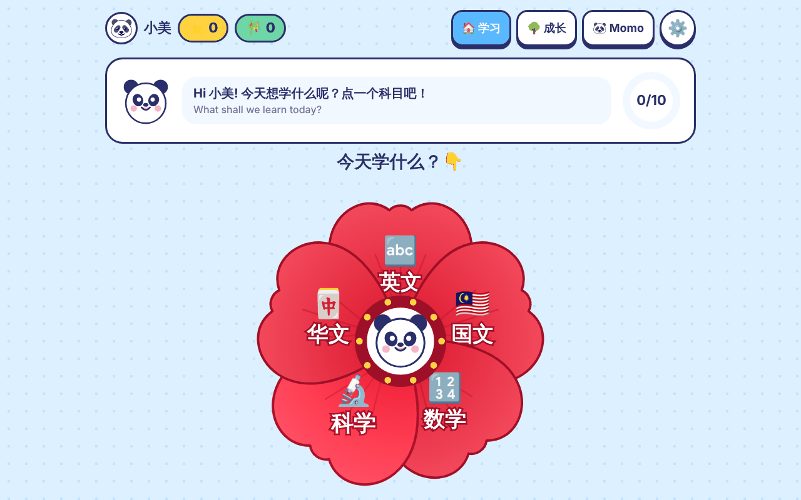
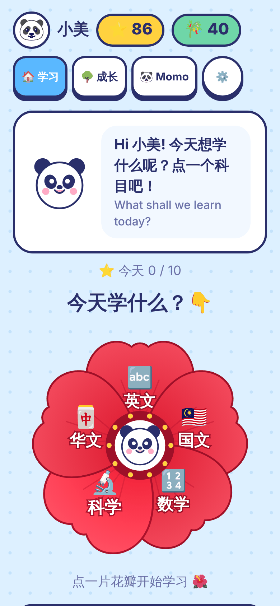
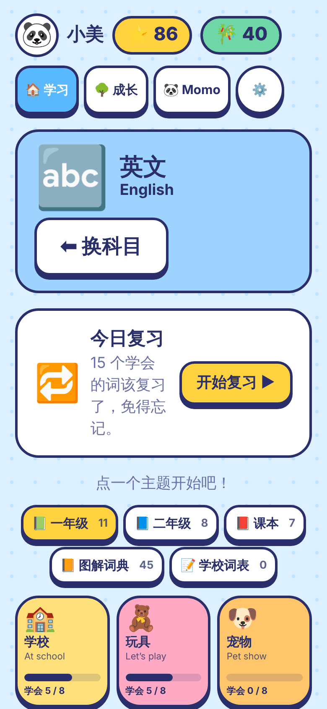
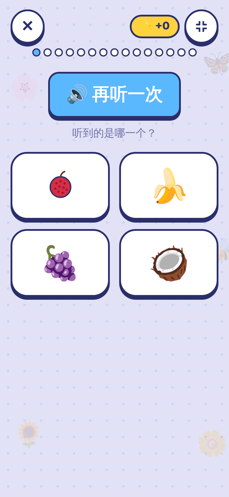
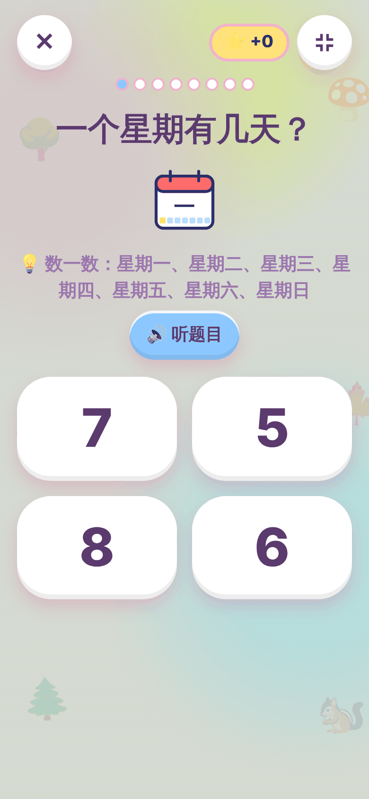
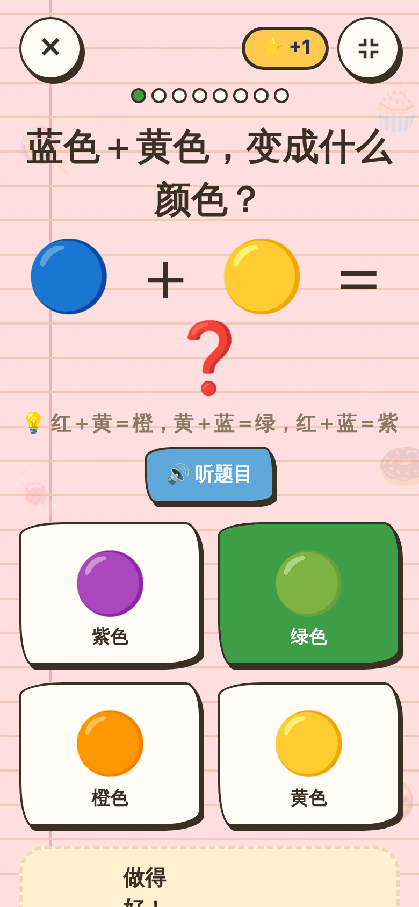
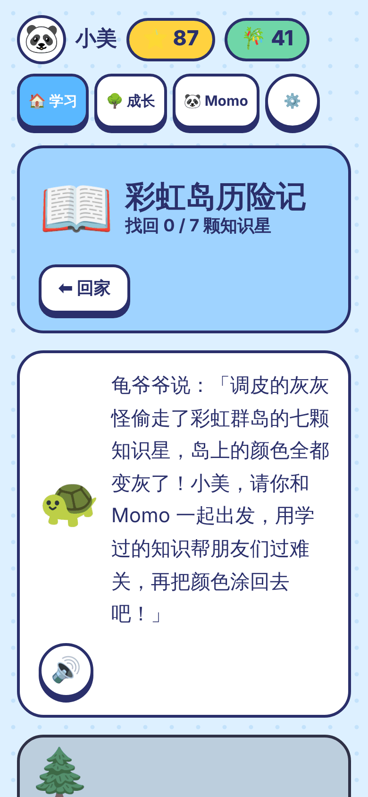
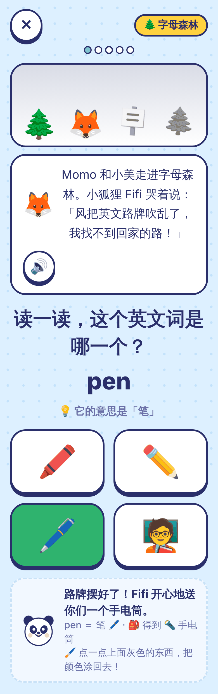
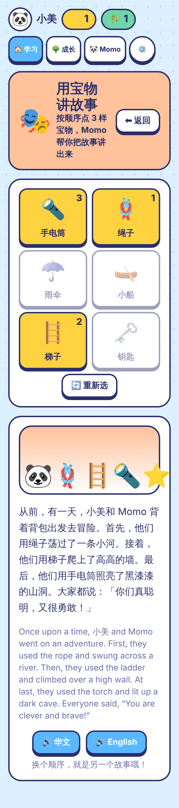

# Momo 学英文·国文·数学·科学 🐼

给马来西亚华小一年级孩子的学习 App：英文、国文、数学、科学、华文，有华文帮助、朗读、跟读录音和成长记录。

## 截图

<table>
<tr>
<td align="center"> 首页：点花瓣选科目</td>
<td align="center"> 英文：按年级和课本分组</td>
<td align="center"> 听一听，选对的图</td>
</tr>
<tr>
<td align="center"> 数学：日历（💡 提示）</td>
<td align="center"> 科学：调颜色</td>
<td align="center"> 📖 彩虹岛历险记</td>
</tr>
<tr>
<td align="center"> 答对后把画涂回颜色</td>
<td align="center"> 🎭 用宝物讲故事</td>
<td></td>
</tr>
</table>

## 打开方式
- 网址：https://sclim999.github.io/kidlearning-/
- iPad / iPhone：用 Safari 打开 › 分享 › 添加到主屏幕
- Android：用 Chrome 打开 › ⋮ › 添加到主屏幕
- Windows：用 Edge 打开（马来语发音通常比较好）

## 内容
- **英文 / 国文**：一年级 11 个主题（对齐 Super Minds 1 Unit 1–4 等）；二年级 8 个主题：星期、衣服、房间、天气、心情、我喜欢做、地方、职业；课本：国文 Unit 4 Kenali Jiran、Unit 10 Berhati-hati Selalu、Unit 13、国文课本 Makan Bersama-sama、Kata Nama Am、Balik ke Kampung（diftong）、Kata Nama Khas、Super Minds 的小青蛙故事、保护色、宠物展、假期天气、in/on/under、七巧板、Colours 颜色（用课本的句子）；图解词典 46 个主题：月份、生日会、火车站（一）（二）、脸、反义词（一）（二）、季节和天气、首都著名建筑物、学校（一）（二）、陆路交通工具、植物的栖息地（一）（二）、淡水鱼（二）、爱好（一）（二）、运动、体育用品、旅馆、水果摊（一）（二）、现代乐器、道德价值、动物的栖息地、城市、材料的性质、惯用语（国文）、食物的味道、长屋、制服团体、警察局、消防和拯救局、人工智能的应用、智能机器人、科学活动、城市与乡村、水上和空中交通工具、传统游戏、传统服装、淡水鱼、职业（一）（二）、书房（一）（二）、药房；没有现成图案的词都画了小图，认识单词、听音选图、看图选词、拼一拼、听写、排句子、今日复习（学会的词会在 1、3、7、14、30 天后再复习）、🗣️ 说说看（Chrome / Edge）
- **数学**：数一数、比多少、加法、减法、凑十、数字接龙、认识形状、认识钱币、认识时钟、应用题、日历（星期和月份）；二年级：1000 以内的数、加减法 1000 以内（直式）、乘法、除法、分数、分一分（二分之一、四分之一）、长度与重量；「🔍 看看里面」有立体图：乘法积木板（点方块选几排几个，一排一排数）、双位数加法（满十进位）、除法平分（一轮一轮分到盘子里）、双位数减法（十位长条和个位小方块，一步一步看怎样借位）
- **华文**：看图识字、听音选字、拼音（含四声）、反义词（大↔小、快↔慢……）、我们的宗教信仰；二年级：34 个新生字的看图识字、听音选字、拼音，还有词语（看图选词语、补字）
- **科学**：生物与非生物、五种感官、动物的身体、植物、磁铁、吸水、泥土、科学室规则、动物住在哪里、植物长在哪里、调颜色、硬软热冷、甜咸酸苦；二年级：人类的成长、动物的成长、植物的成长、光与影子
- **🌍 环游世界**：国旗、首都、动物找家、有名的地方、各国的你好、在哪一洲（52 个国家，会拿星星），「马来西亚旅游胜地」（神山、黑风洞、极乐寺……在哪一州），还有按挂图做的「全世界国旗」（197 国；Windows 不能显示国旗符号，所以在 Windows 上不出现）；还可以打开完整的 World Explorer 3D 地球（世界历史、搭建工坊、漫游世界）
- **🛡️ 病毒猎人**：3D 电脑安全游戏（清除卡通病毒、认识钓鱼邮件）。要用 10 根竹子换 10 分钟，每天最多 2 次，时间到自动回到 Momo，不会玩上瘾；每一关会随机换画风，墙上的电脑零件和颜色也会变；是小朋友模式：病毒血少、走得慢、打得轻，瞄准范围大，没被打会慢慢回血，血用完时 Momo 会帮忙修好，不会 Game Over；默认华文
- **每一轮都不一样**：每玩一轮，会随机换一个场景（海底、太空、森林、糖果屋、农场、花园、城市、玩具房、水果摊）和一个画风，数一数的东西也跟着场景换；可以在家长设置里关掉
- **好玩功能**：养熊猫 Momo（用竹子喂它、买帽子和房间）、翻牌配对、泡泡爆爆、连对 🔥 动画
- **📖 彩虹岛历险记**：一个原创的故事绘画冒险。灰灰怪偷走了彩虹群岛的七颗知识星，岛上变成灰色；孩子跟着 Momo 一岛一岛走（英文、国文、数学、科学、华文、环游世界、最后的云堡），用学过的知识帮朋友们过难关，答对后点一点灰色的东西把颜色涂回去。路上收集手电筒、绳子、梯子等宝物，后面的难关要选对宝物才能过；集齐 3 样还能「用宝物讲故事」，换个顺序就是新故事（华文和英文朗读）。
- **更多玩法**：冒险地图（4 区 20 站 + 大魔王）、卡片册、每日生活任务、亲子对战、错题本、每周小测、Momo 每周来信、每天时间提醒
- **成长记录**：星星、等级、贴纸、14 天图表、每周报告、可打印的每周贴纸表、多个孩子
- **家长**：📊 家长后台（要密码：进度、强项、弱项、兴趣、每周趋势）、学校词表（输入本周要学的词）、备份 / 恢复、家长密码

## 注意
学习记录保存在每台设备自己的浏览器里，不会跨设备同步。清除浏览器资料会把记录一起删掉，所以请在「设置 › 备份 / 恢复」定期下载备份文件；换设备时用它恢复。

打开过一次以后，没有网络也能使用。

整个 App 主要是一个 `index.html` 文件（加上离线用的 `sw.js`、`fig/` 立体图和 `world/` 环游世界），不需要安装任何东西。
